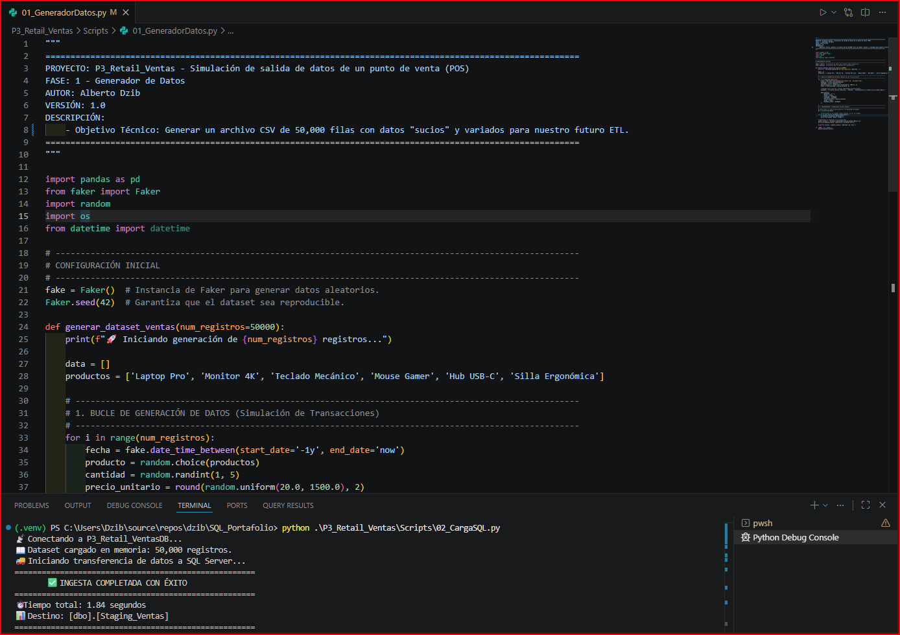
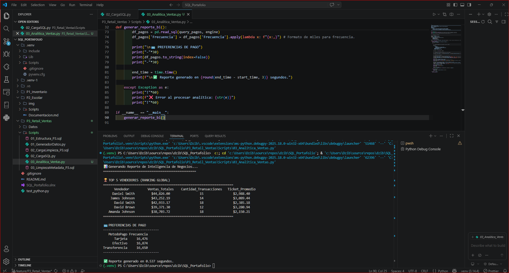

# 📘 Documentación Técnica

## 🐍 Proyecto P03: Pipeline Híbrido de Alto Rendimiento (Python + SQL Server) (V4.0.0)

## 🛍️ [/P3_Retail_Ventas/](./) Retail & Análisis de Ventas (Inteligencia Comercial)

"Transforma transacciones de punto de venta desestructuradas en tableros
ejecutivos de rentabilidad por producto y región. Permite identificar patrones
de compra estacionales para maximizar las campañas de marketing y la retención
de clientes."

---

## 📑 Índice de Navegación Rápida

- [📘 Documentación Técnica](#-documentación-técnica)
  - [🐍 Proyecto P03: Pipeline Híbrido de Alto Rendimiento (Python + SQL Server) (V4.0.0)](#-proyecto-p03-pipeline-híbrido-de-alto-rendimiento-python--sql-server-v400)
  - [🛍️ /P3\_Retail\_Ventas/ Retail \& Análisis de Ventas (Inteligencia Comercial)](#️-p3_retail_ventas-retail--análisis-de-ventas-inteligencia-comercial)
  - [📑 Índice de Navegación Rápida](#-índice-de-navegación-rápida)
  - [Resumen Ejecutivo](#resumen-ejecutivo)
  - [📌 Descripción General](#-descripción-general)
  - [🎯 Objetivo](#-objetivo)
  - [🏗️ Arquitectura Híbrida (Ecosistema estructurado)](#️-arquitectura-híbrida-ecosistema-estructurado)
    - [Estructura del Repositorio](#estructura-del-repositorio)
    - [📊 Evidencias de Rendimiento y Analítica](#-evidencias-de-rendimiento-y-analítica)
    - [🏆 Cuadro de Honor: TOP 5 Vendedores (Ranking Global)](#-cuadro-de-honor-top-5-vendedores-ranking-global)
    - [💳 Preferencias de Pago](#-preferencias-de-pago)
    - [🧠 Retos Técnicos y Soluciones de Ingeniería](#-retos-técnicos-y-soluciones-de-ingeniería)
  - [📅 Próximos Pasos (Roadmap)](#-próximos-pasos-roadmap)
    - [V4.1.0](#v410)
    - [V5.0.0](#v500)
  - [📖 Glosario Técnico y de Impacto (Para Reclutadores y Stakeholders)](#-glosario-técnico-y-de-impacto-para-reclutadores-y-stakeholders)

---

## Resumen Ejecutivo

Implementación de una arquitectura híbrida avanzada para el procesamiento de
 Alto Rendimiento, integrando Python como motor de orquestación y generación
 de datos, y SQL Server 2025 como motor de almacenamiento masivo, limpieza y
 normalización. Arquitectura diseñada para alta disponibilidad, capaz de escalar
 de 50k a 1M de registros manteniendo una tasa de ingesta de ~27,000 registros
 por segundo.

---

## 📌 Descripción General

Proceso fundamentado en la alta concurrencia y el rendimiento de inserción por
 lotes, resolviendo colisiones de llaves únicas y optimizando el flujo de
 trabajo entre scripts de Python y procedimientos relacionales en T-SQL.

* Implementación de una arquitectura híbrida avanzada para el
  procesamiento de Alto Rendimiento, integrando Python como motor de
  orquestación, generación de datos, SQL Server 2025 como motor de
  almacenamiento masivo, limpieza y normalización.
* Arquitectura diseñada para alta disponibilidad, capaz de escalar de
  50k a 1M de registros manteniendo una tasa de ingesta de ~27,000
  registros por segundo.
* Diseñar un ecosistema capaz de generar, ingerir y procesar un
  volumen de 50,000 transacciones en tiempo récord, demostrando la
  eficiencia de la integración híbrida entre lenguajes de
  programación y motores de base de datos.

---

## 🎯 Objetivo

- Diseñar un ecosistema capaz de generar, ingerir y procesar un volumen de
 50,000 transacciones en tiempo récord, demostrando la eficiencia de la
 integración híbrida entre lenguajes de programación y motores de base de datos.


---

## 🏗️ Arquitectura Híbrida (Ecosistema estructurado)

* El proyecto se divide en 6 fases críticas de ingeniería:

1. 01_GeneradorDatos (Python): Generación de dataset sintético de
   50,000 registros mediante la librería `Faker`, utilizando
   semillas de reproducibilidad.
2. 02_CargaSQL (Python): Ingesta masiva optimizada mediante
   SQLAlchemy y `fast_executemany` (Tasa de transferencia:
   ~27k reg/seg).
3. 01_Estructura_P3 (SQL): Diseño de esquemas normalizados
   (`Ventas`, `Catalogos`) y arquitectura relacional blindada.
4. 02_CargaLimpieza_P3 (SQL): Proceso ETL masivo con resolución de
   conflictos `DDL/DML` de llaves únicas y materialización de
   columnas.
5. 03_LimpiezaMetadata_P3 (SQL): Optimización de Esquema: se
   implementa la materialización de datos mediante `ALTER TABLE` y
   un proceso de `UPDATE` masivo orquestado por una `CTE`. Se
   transita de una estructura de 'Staging' a una tabla de
   producción altamente eficiente, aplicando funciones de cadena.
6. 03_Analitica_Ventas (Python): Integración Híbrida exitosa, se
   valida la arquitectura de 'Puente de Datos' logrando tiempos de
   respuesta sub-segundo (`0.53s`) en la generación de reportes de
   negocio Dashboard de BI en consola con formateo profesional de
   KPIs y consumo directo desde SQL.

> *Arquitectura*

* [Arquitectura Lógica](architecture/01_logical_architecture.drawio)

* [Arquitectura Física](architecture/02_physical_architecture.drawio)

* [Arquitectura de Despliegue](architecture/03_deployment_architecture.drawio)

### Estructura del Repositorio


```Plaintext
P03_Retail_Ventas/
│
├── architecture/
│   ├── 01_logical_architecture.drawio
│   ├── 02_physical_architecture.drawio
│   └── 03_deployment_architecture.drawio
│
├── assets/
│   ├── diagrams/
│   └── reports/
│
├── data_sample/
│   └── Ventas_Retail_Masivo.csv
│
├── docs/
│   ├── decisions/
│   ├── functional/
│   ├── operations/
│   └── technical/
│
├── scripts/
│   ├── 01_Estructura_P3.sql
│   ├── 01_GeneradorDatos.py
│   ├── 02_CargaLimpieza_P3.sql
│   ├── 02_CargaSQL.py
│   ├── 03_Analitica_Ventas.py
│   └── 03_LimpiezaMetadata_P3.sql
│
├── tests/
│
├── requirements.txt
│
└── README.md
```

---

### 📊 Evidencias de Rendimiento y Analítica

* 📑 Métricas de Ingesta: Carga masiva completada en 1.84 segundos.
  
* 📈 Métricas de Analítica: Reporte generado en 0.537 segundos.
  

---

### 🏆 Cuadro de Honor: TOP 5 Vendedores (Ranking Global)

> Análisis de desempeño basado en un volumen de 50,000 transacciones

| # | Vendedor | Ventas Totales | Cant. Transacciones | Ticket Promedio |
| :-: | :-: | :-: | :-: | :-: |
| 1 | Daniel Smith | $44,820.80 | 15 | $2,988.05 |
| 2 | James Johnson | $43,332.19 | 14 | $3,095.16 |
| 3 | David Smith | $42,933.17 | 15 | $2,862.21 |
| 4 | David Brown | $39,371.30 | 12 | $3,280.94 |
| 5 | Amanda Johnson | $38,703.72 | 18 | $2,150.21 |

### 💳 Preferencias de Pago

| **#** | **Método de Pago** | **Frecuencia** |
| :---------: | :-----------------------: | :------------------: |
| **1** |          Tarjeta          |        16,476        |
| **2** |         Efectivo         |        16,874        |
| **3** |       Transferencia       |        16,650        |

---

### 🧠 Retos Técnicos y Soluciones de Ingeniería

1. *Sincronización de Middleware:*
   - *Problema:* Establecer una conexión persistente y segura entre
     el entorno virtual de Python y SQL Server 2025.
   - *Solución:* Configuración exitosa de ODBC Driver 17 y
     SQLAlchemy, permitiendo un flujo de datos bidireccional sin
     latencia.
2. *Afinamiento de Infraestructura Local (I/O):*
   - *Problema:* Riesgo de cuellos de botella durante la escritura
     de 50k registros en el disco del sistema.
   - *Solución:* Expansión del volumen lógico del SSD (C:) y
     optimización del "Write Caching", logrando una mejora drástica
     en los tiempos de respuesta.
3. *Colisiones de Unique Key (DDL/DML):*
   - *Problema:* Violación de restricciones de unicidad en el
     catálogo de productos debido a variaciones de precio en el
     origen.
   - *Solución:* Implementación de lógica de agregación MAX() y
     agrupamiento GROUP BY en la fase de carga SQL para asegurar la
     integridad referencial.
4. *Captura de Métricas en Lotes Segmentados:*
   - *Problema:* Pérdida de contexto en variables de sistema como
     @@ROWCOUNT tras instrucciones DDL.
   - *Solución:* Uso estratégico del comando GO para separar lotes
     y captura inmediata de métricas para garantizar la trazabilidad
     total del proceso ETL.

---

## 📅 Próximos Pasos (Roadmap)

### V4.1.0

* Integración de pruebas unitarias con `pytest` para la validación automática
 de scripts de Python.
* Orquestación de tareas mediante programación de pipelines.

### V5.0.0

* Implementación de paneles ejecutivos en tiempo real conectados vía Power BI Services.

* Logging centralizado y monitoreo de salud del pipeline.

---

## 📖 Glosario Técnico y de Impacto (Para Reclutadores y Stakeholders)

* *Pipeline Híbrido:* Arquitectura que combina lenguajes de propósito general
 (Python) para procesamiento flexible y motores especializados (SQL Server)
 para almacenamiento relacional seguro.

* *Fast_executemany:* Característica de optimización en controladores de bases de
 datos que acelera drásticamente las inserciones masivas ejecutando comandos
 parametrizados en lotes.

* *Reproducibilidad:* Capacidad de un script de simulación de generar exactamente
 el mismo conjunto de datos aleatorios utilizando una semilla fija (seed).

* *Sub-segundo:* Tiempos de respuesta inferiores a un segundo, fundamentales
 para garantizar una experiencia de usuario interactiva y fluida en tableros
 de BI.

---

*Autor:* Alberto Dzib
*Versión:* 4.0.0
