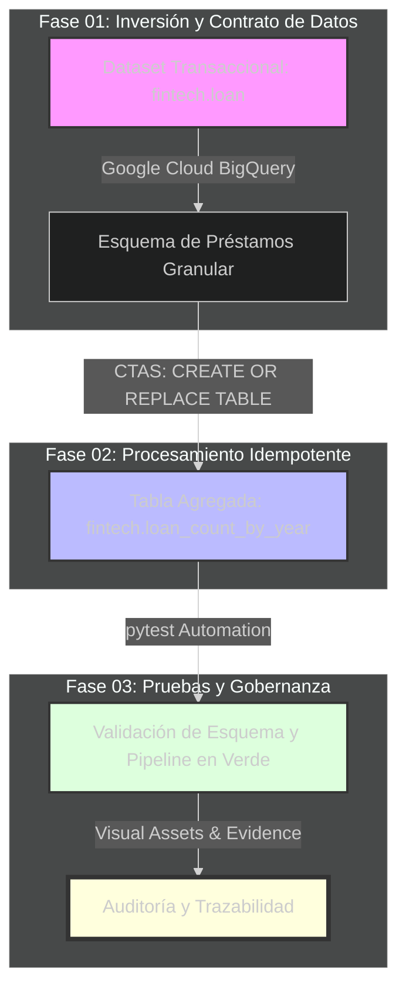
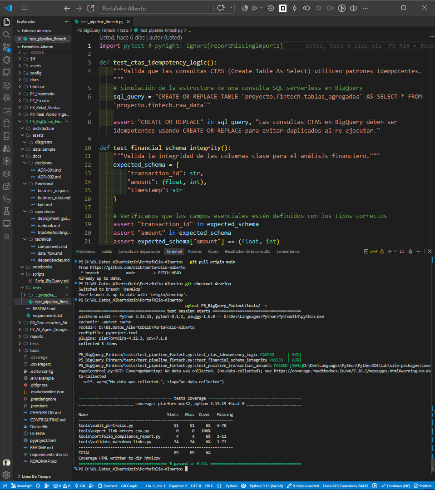
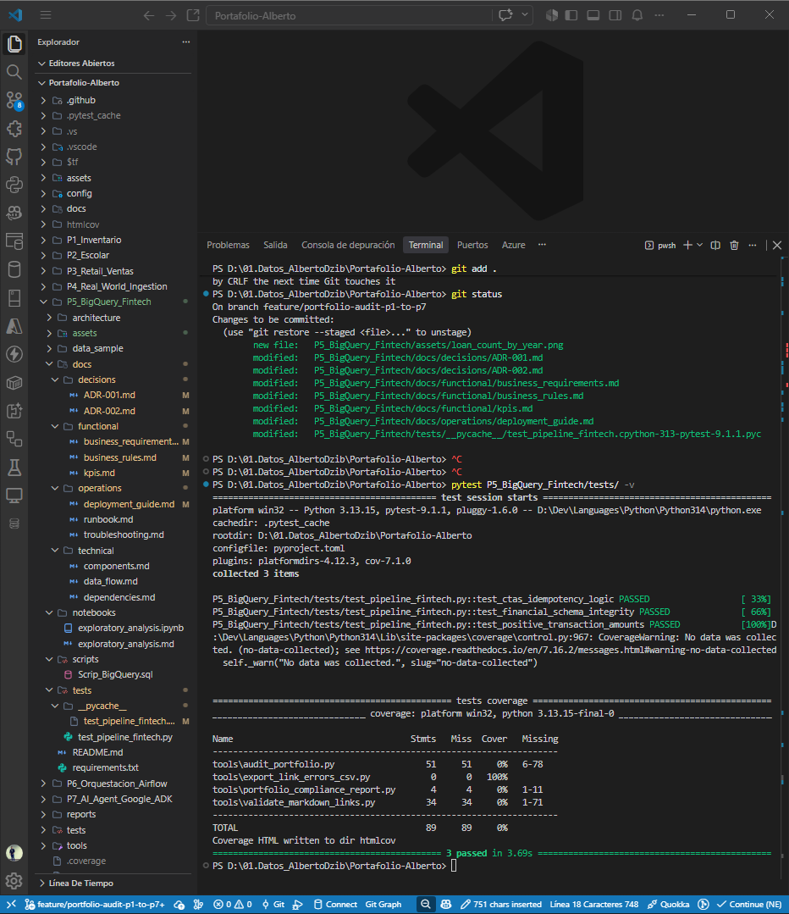

# 📘 Documentación Técnica

## ☁️ Proyecto P05: BigQuery Fintech — Cloud y Escalabilidad

**Versión:** 3.0.0

🗂️ **P05: BigQuery Fintech** (Optimización Serverless y Costos Cloud)

> *"Automatiza la agregación de datos financieros transaccionales en entornos
> cloud serverless mediante consultas idempotentes. Reduce la latencia analítica
> y garantiza la gobernanza estricta para auditorías regulatorias."*

---

## 📑 Índice de Navegación Rápida

- [📘 Documentación Técnica](#-documentación-técnica)
  - [☁️ Proyecto P05: BigQuery Fintech — Cloud y Escalabilidad](#️-proyecto-p05-bigquery-fintech--cloud-y-escalabilidad)
  - [📑 Índice de Navegación Rápida](#-índice-de-navegación-rápida)
  - [📌 Contexto del Proyecto](#-contexto-del-proyecto)
  - [🎯 El Desafío](#-el-desafío)
    - [🖼️ Objetivo](#️-objetivo)
  - [🚀 Retos Técnicos a Resolver](#-retos-técnicos-a-resolver)
  - [🏗️ Estructura Completa del Proyecto (Modular \& Production-Ready)](#️-estructura-completa-del-proyecto-modular--production-ready)
  - [💻 Solución SQL e idempotencia](#-solución-sql-e-idempotencia)
  - [📊 Resultados y esquema de salida](#-resultados-y-esquema-de-salida)
  - [📸 Evidencias visuales y trazabilidad](#-evidencias-visuales-y-trazabilidad)
  - [📝 Bitácora de troubleshooting y decisiones](#-bitácora-de-troubleshooting-y-decisiones)
  - [🌳 Git Flow e infraestructura](#-git-flow-e-infraestructura)
  - [📅 Próximos Pasos (Roadmap)](#-próximos-pasos-roadmap)
    - [V3.1.0](#v310)
    - [V4.0.0](#v400)
  - [📖 Glosario Técnico y de Impacto (Para Reclutadores y Stakeholders)](#-glosario-técnico-y-de-impacto-para-reclutadores-y-stakeholders)

---

## 📌 Contexto del Proyecto

Este proyecto demuestra habilidades prácticas en **Google Cloud BigQuery**
para el procesamiento de datos financieros. A partir de una base de datos transaccional
de préstamos (dataset `fintech`), se requería optimizar las consultas analíticas
futuras.

---

## 🎯 El Desafío

El objetivo principal fue evitar el escaneo repetitivo de datos a nivel
granular mediante la creación de una tabla agregada. Utilizando la declaración
`CTAS` (Create Table As Select), se generó un resumen eficiente que contabiliza
la cantidad total de préstamos emitidos agrupados por año (`issue_year`).



### 🖼️ Objetivo

Implementar un pipeline analítico de alto rendimiento y optimización de
costos en **Google Cloud BigQuery** para procesamiento financiero masivo. A
partir de una base de datos transaccional de préstamos (`fintech.loan`), se
diseñó una estrategia de agregación mediante la declaración `CTAS` (Create
Table As Select) con el patrón de idempotencia `CREATE OR REPLACE`,
eliminando el escaneo repetitivo de datos granulares.

---

## 🚀 Retos Técnicos a Resolver

**Optimización de Costos en Cloud:** Reducción drástica del volumen de
bytes escaneados en consultas analíticas recurrentes sobre tablas
particionadas.

**Idempotencia Operativa:** Garantizar que los scripts CTAS puedan ejecutarse
de forma repetible y segura sin duplicar estados o generar excepciones de
objetos existentes mediante `CREATE OR REPLACE`.

**Automatización de Calidad (QA):** Integración de pruebas unitarias
automatizadas con pytest para validar la correcta ejecución de la tubería
analítica en entornos cloud.

---

## 🏗️ Estructura Completa del Proyecto (Modular & Production-Ready)

El módulo está estructurado bajo una arquitectura desacoplada y estricta:

* `architecture/`: Documentación conceptual y diagramas de diseño del pipeline
en BigQuery.

* `assets/`: Evidencias visuales, diagramas y capturas de consola para
auditoría externa.

* `data_sample/`: Muestras de datos estructuradas para pruebas locales y
validación de esquemas.

* `docs/`: Documentación técnica, decisiones de arquitectura (ADRs),
requerimientos funcionales y manuales de operaciones.

* `notebooks/`: Cuadernos interactivos para análisis exploratorio de datos
(EDA) y pruebas de concepto.

* `scripts/`: Sentencias y scripts optimizados en Standard SQL para BigQuery.

* `tests/`: Pruebas unitarias de integración automatizadas con pytest.

* `requirements.txt`: Dependencias técnicas del ecosistema de Python/BigQuery.

* `README.md`: Documentación principal del módulo.

---

📂 Mapa Estructural

```text
P5_BigQuery_Fintech/
├── architecture/       # Diagramas y modelos conceptuales
├── assets/              # Evidencias visuales y diagramas
│   ├── diagrams/
│   └── evidence/        # Capturas de ejecución y consola GCP
├── data_sample/         # Muestras de datos y metadatos
├── docs/                # Documentación de ingeniería y gobernanza
│   ├── decisions/       # Registros de decisiones de arquitectura
│   ├── functional/      # Requerimientos y reglas de negocio
│   ├── operations/      # Guías de despliegue y troubleshooting
│   └── technical/       # Componentes, flujos y dependencias
├── notebooks/           # EDA y validación analítica interactiva
├── scripts/             # Scripts SQL de agregación y modelado
├── tests/               # Pruebas automatizadas con pytest
├── requirements.txt     # Dependencias de Python
└── README.md            # Documentación principal
```

---

## 💻 Solución SQL e idempotencia

El script principal automatiza la agregación anual de préstamos mediante
Standard SQL en Google Cloud:

```sql
CREATE OR REPLACE TABLE fintech.loan_count_by_year AS
SELECT
    issue_year,
    COUNT(loan_id) AS total_loans
FROM fintech.loan
GROUP BY issue_year;
```

---

## 📊 Resultados y esquema de salida

La ejecución aprovisionó la tabla `loan_count_by_year` con este contrato:

* - `issue_year` (**NUMERIC**): Año fiscal de emisión de los créditos.
* - `total_loans` (**INTEGER**): Conteo de préstamos por período.

## 📸 Evidencias visuales y trazabilidad

Las capturas de pantalla que validan la ejecución correcta del script en la
consola, la estructura en VS Code y los resultados de las pruebas unitarias
automatizadas (`pytest`) se encuentran organizadas en la ruta oficial de
evidencias:

* Script BigQuery en VS Code:
 
* Pruebas unitarias con pytest:
 

Puedes consultar las evidencias visuales (capturas de la consola de GCP y el
esquema resultante) en el documento PDF adjunto a este repositorio.

---

## 📝 Bitácora de troubleshooting y decisiones

1. **Control de idempotencia en BigQuery**

   - **Reto:** Evitar fallos al reejecutar scripts de creación de tablas.
   - **Solución:** Usar `CREATE OR REPLACE TABLE` para actualizar el modelo
     analítico de forma limpia y atómica.

2. **Sincronización de entornos de pruebas**

   - **Reto:** Aislar las pruebas de integración de los componentes cloud.
   - **Solución:** Estructurar pruebas con pytest y validarlas localmente.

---

## 🌳 Git Flow e infraestructura

- **Gobernanza:** Desarrollo por ramas `feature/` y sincronización con
  `develop` y `main`.
- **Trazabilidad:** Versionado de artefactos visuales y documentación técnica.

---

## 📅 Próximos Pasos (Roadmap)

### V3.1.0

Implementación de particionamiento por fecha de emisión y clustering por región
 en BigQuery para reducir aún más el costo de bytes escaneados.
Automatización del despliegue mediante GitHub Actions.

### V4.0.0

Integración de flujos de ingesta en tiempo real utilizando Google Cloud Pub/Sub
 y Dataflow.

---

## 📖 Glosario Técnico y de Impacto (Para Reclutadores y Stakeholders)

* **Serverless Cloud Analytics**: Modelo de arquitectura de datos en la nube
  donde la infraestructura es administrada por el proveedor (Google Cloud),
  permitiendo escalar el procesamiento analítico sin aprovisionar servidores
  manualmente.

* **CTAS (Create Table As Select)**: Instrucción SQL estándar que permite
  crear una tabla nueva a partir del resultado de una consulta, facilitando
  la materialización de vistas y la agregación de datos.

* **Idempotencia Operativa**: Principio de ingeniería que asegura que un
  script o comando pueda ejecutarse múltiples veces obteniendo siempre el
  mismo resultado sin generar duplicados ni alterar el estado esperado del
  sistema.

* **Bytes Escaneados**: Métrica de consumo en BigQuery que determina el
  volumen de datos leídos del almacenamiento columnar para satisfacer una
  consulta, sirviendo como base para la optimización de costos.

---

* **Autor:** Jesús Alberto Dzib Ku

Versión: 3.0.0
