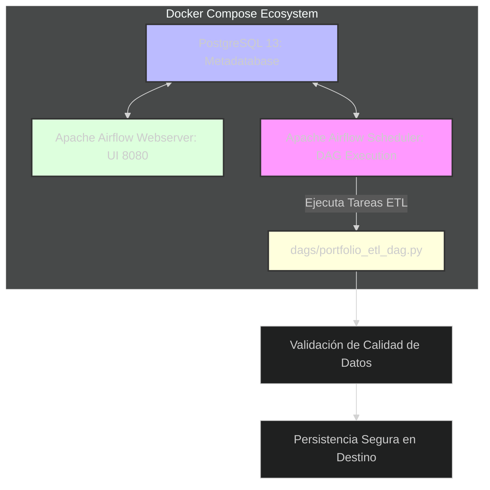

# 📘 Documentación Técnica

## 🚀 Proyecto P06: Orquestación Enterprise & Contenerización

### (Apache Airflow & Docker)

> **P06: Orquestación con Apache Airflow** — *Resiliencia Operativa y Automatización*
> *"Automatización, tolerancia a fallos y despliegues idempotentes de punta a
> punta mediante pipelines autogestionados y contenerizados."*

---

## 📑 Índice de Navegación Rápida

<!-- markdownlint-disable MD013 MD007 MD051 -->
- [📋 Resumen Ejecutivo](#-resumen-ejecutivo)
- [🛠️ Stack Tecnológico](#️-stack-tecnológico)
- [🏗️ Arquitectura de Contenerización](#️-arquitectura-de-contenerización)
- [🐳 (Docker \& Airflow)](#docker--airflow)
- [📂 Estructura del Proyecto](#-estructura-del-proyecto)
- [(Modular \& Production-Ready)](#modular--production-ready)
- [💻 Implementación del DAG (Apache Airflow)](#-implementación-del-dag-apache-airflow)
- [📸 Evidencias de Ejecución y Trazabilidad](#-evidencias-de-ejecución-y-trazabilidad)
- [📝 Bitácora de Troubleshooting](#-bitácora-de-troubleshooting)
    - [(🧠 Retos Superados)](#-retos-superados)
- [📅 Próximos Pasos (Roadmap)](#-próximos-pasos-roadmap)
    - [V3.1.0](#v310)
    - [V4.0.0](#v400)
- [📖 Glosario Técnico y de Impacto (Para Reclutadores y Stakeholders)](#-glosario-técnico-y-de-impacto-para-reclutadores-y-stakeholders)
<!-- markdownlint-disable MD013 MD007 MD051 -->

## 📋 Resumen Ejecutivo

- **Situación:** Los pipelines de datos desarrollados en los módulos
  anteriores requerían ejecución manual y carecían de un sistema
  automatizado de control de dependencias, lo que representaba un riesgo
  operativo ante fallos en la ingesta o transformación masiva.
- **Tarea:** Diseñar e implementar una arquitectura de orquestación moderna
  y un entorno de ejecución completamente contenerizado que garantice
  despliegues universales y gobernanza de flujos (*End-to-End*).
- **Acción:**
  - Se configuró un entorno aislado basado en **Docker y Docker
    Compose** (`LocalExecutor` con PostgreSQL como backend de
    metadatos).
  - Se desarrolló un DAG transaccional en **Apache Airflow**
    (`portfolio_etl_dag.py`) que integra tareas de extracción,
    validación automatizada de calidad de datos (`Data Quality Testing`) y carga segura.
- **Resultado:** Un ecosistema portable de "Un Clic" (`docker compose up`) que elimina la fricción de dependencias locales y
  asegura la observabilidad y el monitoreo en tiempo real de los
  procesos de datos.

---

## 🛠️ Stack Tecnológico

- **Orquestador:** Apache Airflow (v2.7.2)
- **Contenerización:** Docker & Docker Compose
- **Base de Datos (Metadatos):** PostgreSQL (v13)
- **Lenguaje:** Python 3.10+

---

## 🏗️ Arquitectura de Contenerización

### (Docker & Airflow)



---

## 📂 Estructura del Proyecto

### (Modular & Production-Ready)

```Plaintext
P06_Orquestacion_Airflow/
├── architecture/                 # Modelos lógicos, físicos y de despliegue
│   ├── 01_logical_architecture.drawio
│   ├── 02_physical_architecture.drawio
│   ├── 03_deployment_architecture.drawio
│   └── components.md
├── assets/                       # Evidencias visuales de la UI de Airflow
│   └── evidence/
├── dags/
│   └── portfolio_etl_dag.py      # Pipeline principal orquestado
├── docs/                         # Documentación de ingeniería y gobernanza
│   ├── decisions/                # ADRs (Architecture Decision Records)
│   ├── functional/               # Reglas de negocio y KPIs
│   ├── operations/               # Guías de despliegue, runbooks y troubleshooting
│   └── technical/                # Diccionario de datos y flujos
├── logs/                         # Registro de ejecuciones y auditoría
├── plugins/                      # Módulos y extensiones personalizadas
├── tests/                        # Pruebas unitarias de integridad de DAGs
├── docker-compose.yml            # Arquitectura de infraestructura aislada
├── Dockerfile                    # Configuración del entorno de ejecución
├── requirements.txt              # Dependencias de Python adicionales
└── README.md                     # Documentación principal del módulo
```

---

## 💻 Implementación del DAG (Apache Airflow)

El flujo de trabajo automatiza la tubería analítica asegurando el orden
 secuencial y manejo de reintentos ante fallos de red o recursos:

```Python
from airflow import DAG
from airflow.operators.python import PythonOperator
from datetime import datetime, timedelta

default_args = {
    'owner': 'data_engineer',
    'depends_on_past': False,
    'email_on_failure': False,
    'retries': 2,
    'retry_delay': timedelta(minutes=5),
}

with DAG(
    'portfolio_etl_dag',
    default_args=default_args,
    description='Pipeline ETL orquestado para portafolio de datos',
    schedule_interval='@daily',
    start_date=datetime(2026, 1, 1),
    catchup=False,
) as dag:

    def run_extraction():
        print("Iniciando extracción masiva de datos...")

    def run_data_quality_checks():
        print("Ejecutando pruebas de calidad y nulos...")

    def run_load():
        print("Cargando datos hacia la capa analítica...")

    t1 = PythonOperator(task_id='extract_data', python_callable=run_extraction)
    t2 = PythonOperator(task_id='data_quality_checks', python_callable=run_data_quality_checks)
    t3 = PythonOperator(task_id='load_to_analytics', python_callable=run_load)

    t1 >> t2 >> t3
```

---

## 📸 Evidencias de Ejecución y Trazabilidad

Consola de Airflow Webserver (DAG Graph View):

assets/evidence/airflow_dag_graph_success.png

Pruebas Unitarias de Integridad (Pytest):

tests/test_dag_integrity.py

---

## 📝 Bitácora de Troubleshooting

### (🧠 Retos Superados)

1. Gestión de Memoria en Contenedores Docker

* Reto: El demonio de Airflow Scheduler consumía recursos excesivos en entornos
  locales de recursos limitados.
* Solución: Ajuste fino de los parámetros de paralelismo y concurrencia en el
  archivo de configuración airflow.cfg montado por volumen.

1. Persistencia de Metadatos ante Reinicios

* Reto: Pérdida de estados de ejecuciones pasadas al apagar los contenedores.
* Solución: Configuración de un volumen persistente de Docker (postgres_data)
  vinculado al contenedor de PostgreSQL de metadatos.

---

## 📅 Próximos Pasos (Roadmap)

### V3.1.0

* Integración de notificaciones automáticas mediante Webhooks hacia canales de
  Slack ante fallos críticos en tareas del DAG.
* Implementación de sensores personalizados para verificar la llegada de
  archivos fuente en S3 / Google Cloud Storage antes de disparar la extracción.

### V4.0.0

* Despliegue de la infraestructura de Airflow en Kubernetes utilizando
  operadores nativos (KubernetesPodOperator).

---

## 📖 Glosario Técnico y de Impacto (Para Reclutadores y Stakeholders)

* *Orquestación de Workflows:* Práctica de coordinar, programar y monitorear tareas
  interdependientes distribuidas en múltiples sistemas a lo largo de un pipeline
  de datos.
* *DAG (Directed Acyclic Graph):* Estructura matemática y concepto central
  en Apache Airflow que define el orden de ejecución y las dependencias lógicas
  de las tareas sin bucles infinitos.
* *Idempotencia en Orquestación:* Capacidad de una tarea o pipeline de
  re-ejecutarse múltiples veces ante fallos sin duplicar registros ni corromper
  el estado del almacenamiento destino.
* *Contenerización:* Enfoque de virtualización a nivel de sistema operativo que
  empaqueta una aplicación junto con todas sus dependencias en un contenedor
  ligero y reproducible (Docker).

---

Autor: Jesús Alberto Dzib Ku

Versión: 3.0.0
