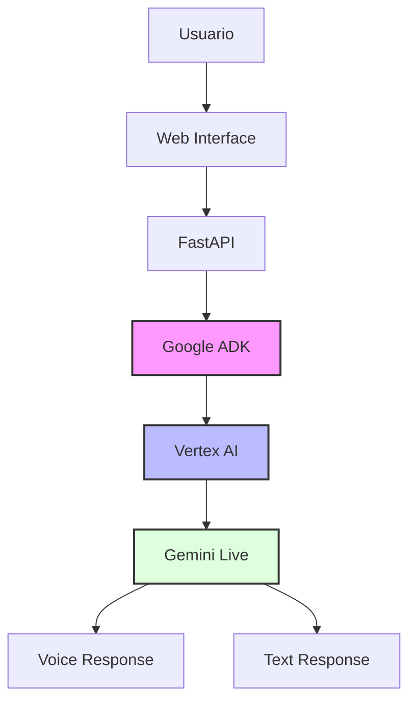
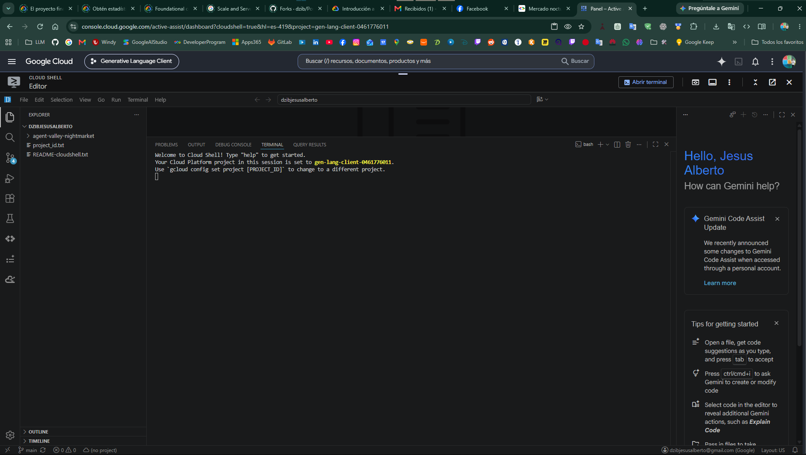
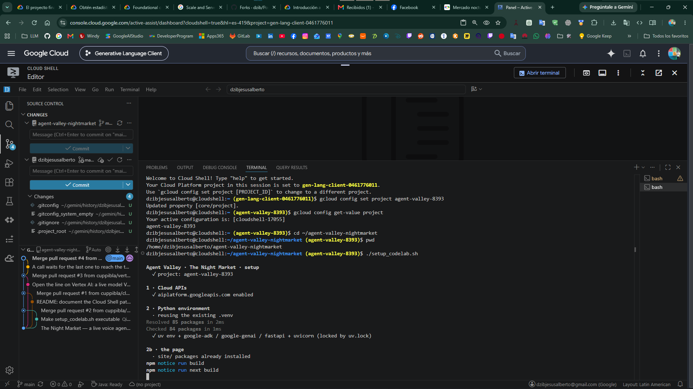
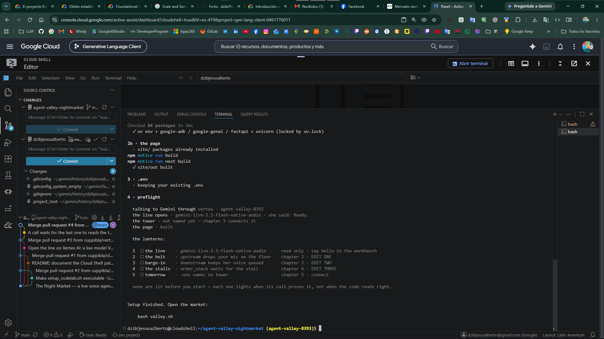
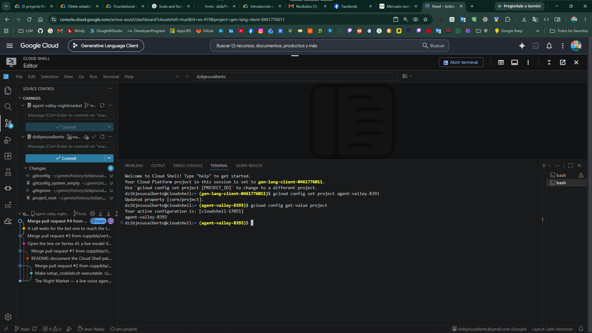
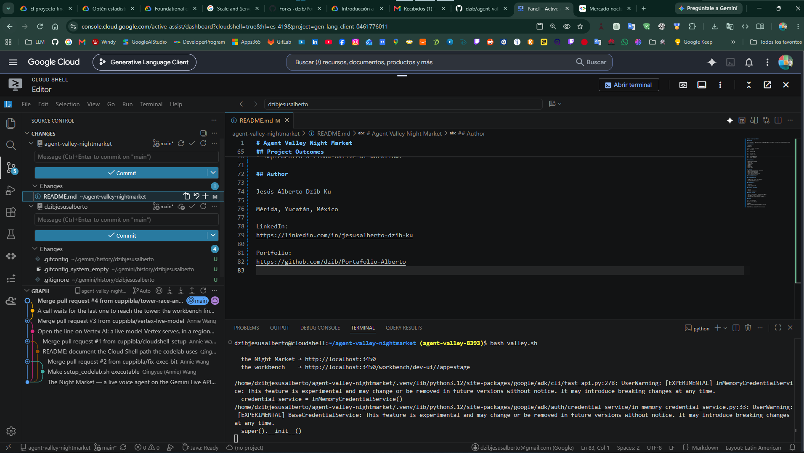

<!-- markdownlint-disable MD013 MD007 MD051 -->
# 📘 Documentación Técnica

## 🚀 Proyecto P07: Agent Valley Night Market (IA Aplicada)

> **P07: Agente Conversacional con Google ADK y Gemini Live** — *Automatización Cognitiva*
> *"Automatiza la atención y el análisis operativo del mercado mediante asistentes inteligentes basados en Vertex AI y Gemini Live. Optimiza la interacción con el usuario final y reduce los costos operativos de soporte en un esquema escalable."*

---

## 📑 Índice de Navegación Rápida

- [Resumen Ejecutivo](#-resumen-ejecutivo)
- [Stack Tecnológico](#-stack-tecnológico)
- [Arquitectura de la Solución](#-arquitectura-de-la-solución)
- [Estructura del Proyecto](#-estructura-del-proyecto)
- [Evidencias de Ejecución](#-evidencias-de-ejecución)
- [Glosario Técnico y de Impacto](#-glosario-técnico-y-de-impacto)

---

## 📄 Resumen Ejecutivo

- **Situación:** Se requería optimizar la interacción con los usuarios finales del mercado y reducir los costos operativos de soporte sin sacrificar la calidad de la atención.
- **Tarea:** Diseñar y desplegar un agente conversacional nativo en la nube capaz de procesar interacciones de audio y texto en tiempo real.
- **Acción:** Se implementó una solución orquestada con **Google Agent Development Kit (ADK)**, consumiendo modelos de **Vertex AI** y **Gemini Live**, expuesta a través de una API construida con **FastAPI**.
- **Resultado:** Despliegue exitoso de un agente conversacional escalable, demostrando habilidades avanzadas en Cloud Engineering (GCP), Generative AI (Prompt Engineering) y Software Development.

---

## 🛠️ Stack Tecnológico

- **Framework de IA:** Google Agent Development Kit (ADK)
- **Modelos Fundacionales:** Google Vertex AI / Gemini Live
- **Backend & APIs:** FastAPI, Python, JavaScript
- **Entorno Cloud:** Google Cloud Platform (GCP), Cloud Shell

---

## 🏗️ Arquitectura de la Solución



---

### 📁 Estructura del Proyecto

```Plaintext
P07_AI_Agent_Google_ADK/
├── docs/                         # Documentación técnica, funcional y de arquitectura
│   ├── architecture/
│   ├── screenshots/
│   └── technical/
├── scripts/                      # Scripts de automatización en bash (setup_project.sh, etc.)
├── assets/                       # Capturas y evidencias visuales
├── src/                          # Código fuente de integración FastAPI y ADK
├── pyproject.toml / uv.lock      # Gestión moderna de dependencias de Python
└── README.md                     # Documentación principal estandarizada
```

---

### 📖 Glosario Técnico y de Impacto

* *Google ADK:* Herramienta para la orquestación y desarrollo acelerado de agentes de IA.

* *Vertex AI:* Plataforma unificada de Machine Learning en GCP para entrenar y desplegar modelos.

* *Gemini Live:* Modelo multimodal avanzado de Google para interacciones conversacionales dinámicas (texto y voz).

* *FastAPI:* Framework moderno y de alto rendimiento para construir APIs web en Python.

* *Cloud Shell:* Entorno de línea de comandos interactivo en el navegador provisto por Google Cloud.

---

## Documentación

| Documento | Descripción |
|-----------|-------------|
| architecture.md | Arquitectura de la solución |
| implementation.md | Implementación técnica |
| lessons-learned.md | Project Learnings |

---

## Tecnologías

- Google Cloud Platform
- Vertex AI
- Gemini Live
- Google ADK
- FastAPI
- Python
- JavaScript
- Cloud Shell

---

## Características

- Interacción conversacional en tiempo real
- Integración de Gemini Live
- Implementación nativa en la nube
- Comunicación de audio y texto
- Orquestación de IA de Vertex

---

## Habilidades demostradas

### Cloud Engineering

- Google Cloud Project Configuration
- API Enablement
- Authentication Management

### Generative AI

- AI Agents
- Prompt Engineering
- Gemini Live

### Software Development

- FastAPI
- Python
- Frontend Integration

+--

## Project Outcomes

- Built a functioning AI conversational agent.
- Configured Vertex AI services.
- Deployed and tested Google ADK components.
- Implemented a cloud-native AI workflow.

---

## Project Evidence

| Evidence | Description |
|-----------|-------------|
| cloudshell.png | Environment Setup |
| project-created.png | Google Cloud Project Creation |
| vertex-ai-enabled.png | Vertex AI Enabled |
| gemini-connected.png | Gemini Connected |
| setup-complete.png | Successful Deployment |
| demo.png | Running Application |

### Environment Setup



### Deployment



### Setup Completed



"El código fuente completo y los scripts de despliegue se ejecutaron en Google
Cloud Shell a través del repositorio oficial de Agent Valley Night Market."

### Application Running



---

## Demonstración



### Configuración del entorno


### Setup completado


* Creación de Proyecto GCP: ../assets/P7/img/screenshots/project-created.png
* Habilitación de Vertex AI: ../assets/P7/img/screenshots/vertex-ai-enabled.png
* Conexión con Gemini Live: ../assets/P7/img/screenshots/gemini-connected.png
* Setup Completado: ../assets/P7/img/screenshots/setup-complete.png
* Aplicación en Ejecución (Demo): ../assets/P7/img/screenshots/demo.png

### Resultados del proyecto

- He creado un agente conversacional de IA completamente funcional.
- Servicios de Vertex AI configurados.
- Se han implementado y probado los componentes de Google ADK.
- Implementé un flujo de trabajo de IA nativo de la nube.

- Proyecto creado y API habilitada.
- Configuración completada
"El código fuente completo y los scripts de despliegue se ejecutaron en
Google Cloud Shell a través del repositorio oficial de Agent Valley Night Market."

---

## Evidencias de Ejecución

El código fuente completo y los scripts de despliegue se ejecutaron en Google Cloud Shell habilitando las APIs correspondientes a través del repositorio oficial de Agent Valley Night Market.

1. Configuración del Entorno (Cloud Shell)
2. Creación de Proyecto GCP
3. Habilitación de Vertex AI
4. Conexión con Gemini Live
5. Setup Completado
6. Aplicación en Ejecución (Demo)

---

## Glosario Técnico y de Impacto

* *Google ADK:* Herramienta para la orquestación y desarrollo acelerado de agentes de IA.

* *Vertex AI:* Plataforma unificada de Machine Learning en GCP para entrenar y desplegar modelos.

* *Gemini Live:* Modelo multimodal avanzado de Google para interacciones conversacionales dinámicas (texto y voz).

* *FastAPI:* Framework moderno y de alto rendimiento para construir APIs web en Python.

* *Cloud Shell:* Entorno de línea de comandos interactivo en el navegador provisto por Google Cloud.

---

## Author

Alberto Dzib

LinkedIn: [Alberto Dzib](https://linkedin.com/in/alberto-dzib)

Portfolio: [Portafolio-Alberto](https://github.com/dzib/Portafolio-Alberto)
