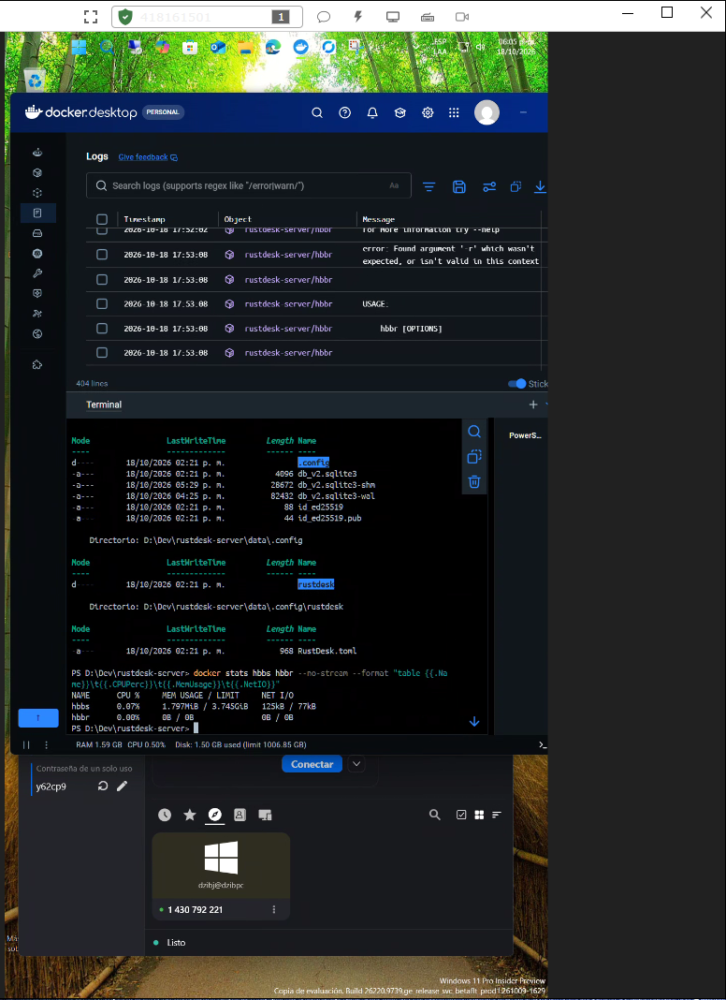
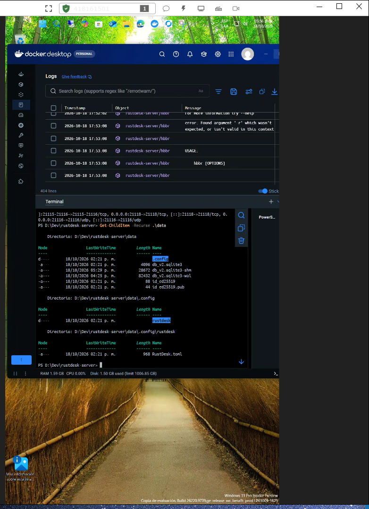

<!-- markdownlint-disable MD013 MD007 MD051 -->

# Módulo P10: Secure On-Premises Remote Desktop Infrastructure (RustDesk Server OSS)

[🏠 Volver al Inicio](../README.md) | [📚 Ver Roadmap](../ROADMAP.md)

---

## 📋 Índice de Navegación Rápida

- [1. Resumen Ejecutivo (Método STAR)](#-1-resumen-ejecutivo-método-star)
- [2. Arquitectura de la Solución](#-2-arquitectura-de-la-solución)
- [3. Configuración de Infraestructura](#-3-configuración-de-infraestructura)
- [4. Guía de Despliegue y Aprovisionamiento](#-4-guía-de-despliegue-y-aprovisionamiento)
- [5. Configuración de Clientes](#-5-configuración-de-clientes)

---

## 🎯 1. Resumen Ejecutivo (Método STAR)

* **Situación:** Las organizaciones y entornos de desarrollo modernos requieren capacidades de soporte y control remoto que garanticen la soberanía y privacidad de los datos, evitando la dependencia absoluta de pasarelas de terceros o servicios cloud externos.
* **Tarea:** Diseñar, desplegar y documentar una infraestructura de escritorio remoto auto-hospedada (*Self-Hosted*) utilizando código abierto (*Open Source*), garantizando el aislamiento de servicios mediante microcontenedores y cifrado de extremo a extremo.
* **Acción:** Implementación de un clúster local de RustDesk Server OSS (`hbbs` y `hbbr`) orquestado con Docker Compose en un entorno Windows/WSL, gestionando volúmenes persistentes y control de puertos de red.
* **Resultado:** Un gateway de acceso remoto seguro, independiente y listo para producción, con persistencia de datos y llaves criptográficas validadas.

---

## 🏗️ 2. Arquitectura de la Solución

El despliegue separa responsabilidades en dos microservicios complementarios gestionados por Docker:

1. **`hbbs` (RustDesk ID / Rendezvous Server):** Gestiona la libreta de direcciones, coordinación de conexiones e intercambio de claves de cifrado (`ed25519`).
2. **`hbbr` (RustDesk Relay Server):** Actúa como pasarela de retransmisión de tráfico cuando una conexión directa punto a punto (P2P / NAT) no es posible.

```text
+---------------------------------------------------------------+
|                    Docker Host (Windows / WSL)                |
|                                                               |
|  +--------------------+             +----------------------+  |
|  |     Container      |             |      Container       |  |
|  |       hbbs         | <---------> |         hbbr         |  |
|  |  (ID & Rendezvous) |             |    (Relay Gateway)   |  |
|  +--------------------+             +----------------------+  |
|           |                                     |             |
|           +-----------------+-------------------+             |
|                             |                                 |
|                    Volume Persistence                         |
|                       (./data:/root)                          |
+---------------------------------------------------------------+
```

---

## ⚙️ 3. Configuración de Infraestructura (`docker-compose.yml`)

```yaml
services:
  hbbs:
    container_name: hbbs
    image: rustdesk/rustdesk-server:latest
    command: hbbs
    volumes:
      - ./data:/root
    restart: unless-stopped
  hbbr:
    container_name: hbbr
    image: rustdesk/rustdesk-server:latest
    command: hbbr
    volumes:
      - ./data:/root
    restart: unless-stopped
```

---

## 🚀 4. Guía de Despliegue y Aprovisionamiento

1. Ubicarse en el directorio del módulo:

```PowerShell
cd P10_Secure_OnPrem_Remote_Desktop_Infrastructure
```

1. Iniciar los servicios en segundo plano:

```PowerShell
docker compose up -d
```

1. Verificar el estado de los contenedores:

```PowerShell
docker ps
```

1. Obtener la Clave Pública de Cifrado (Key):


```PowerShell
docker logs hbbs
```

> **Nota:** Busca en la salida de la consola la línea que contiene la clave pública (Key: ...) generada automáticamente en el par de claves ed25519.

---

## 🔐 5. Configuración de Clientes

En las aplicaciones cliente de RustDesk que desearas conectar a este servidor propio:

* Ir a Configuración -> Red.

* Asignar la IP del servidor en ID Server y Relay Server.

* Ingresar la Key pública obtenida en los logs del contenedor hbbs.

---

## Evidencia de Rendimiento y Arquitectura Atómica



